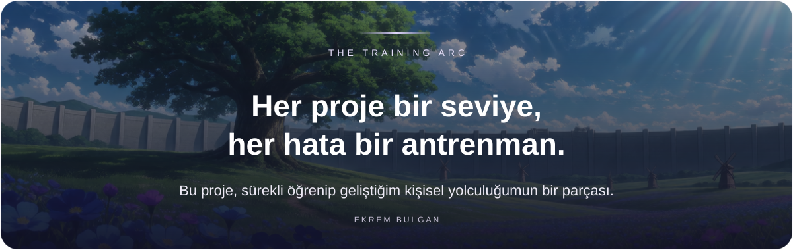

<p align="center"><a href="README.md">English</a> &nbsp; / &nbsp; <a href="README.tr.md">Türkçe</a></p>

# Yerel AI Çalışma İstasyonu

Sohbet, kod yardımı, görsel üretimi ve isteğe bağlı ses araçlarını birleştiren yerel Linux uygulaması. React, TypeScript, FastAPI ve SQLite kullanır.

[Kurulum](docs/INSTALLATION.md) · [Kullanım](docs/USER_GUIDE.md) · [Testler](docs/TESTING.md)

**Deneysel masaüstü prototipi.** İlk donanım denemeleri CachyOS ve AMD RX 6800 XT üzerinde yapıldı. Model ağırlıkları ve çıkarım motorları depoya dahil değildir; her motor ayrıca kurulup doğrulanmalıdır.

## Başlatma

Linux, Python 3.12–3.14 ve Node.js 22+ gerekir. İndirdiğiniz depo klasöründe:

```bash
bash setup.sh
cp .env.example .env
# Gerekirse .env içindeki model ve ComfyUI yollarını değiştirin.
bash start.sh
```

Adres: **http://127.0.0.1:8000**. Kapatmak için `Ctrl+C`. Geliştirme: `bash start.sh --dev`.

Kurulum yalnızca uygulamanın bağımlılıklarını yükler. Arayüz modeller olmadan açılabilir; üretim için ilgili motor ve model dosyaları gerekir. Sohbet motoru `PATH` içindeki `llama-server` çalıştırılabilir dosyasıdır. Bu sürüm LM Studio veya Ollama sunucusuna bağlanmaz.

## Özellikler ve sınırlar

- Akışlı sohbet, geçmiş, iptal ve kesilen yanıtı devam ettirme.
- Kayıtlı proje içindeki dosyalara erişen, fark önizlemesi ve yazma onayı sunan kod çalışma alanı.
- ComfyUI ile görsel üretimi, FLUX.2 Klein düzenlemesi, galeri ve kalıcı işler.
- Yönetilen servisler arasında ortak GPU kilidi.
- Motor doğrulaması sonrasında isteğe bağlı TTS, ses klonlama ve konuşma/şarkı dönüşümü.
- Deneysel Krita editörü, açık/koyu tema ve 11 arayüz dili.

AMD odaklı Linux uygulamasıdır; NVIDIA, Windows ve macOS doğrulanmadı. Video üretimi, sohbet içinde görsel anlama ve belge çalışma alanı bu sürümde yoktur. Model kataloğu sabittir; genel model içe aktarma ekranı bulunmaz. Ses ve Krita araçları ek kurulum ister. Ayrıntılı sınırlar [English README](README.md) ve kurulum belgesindedir.

Varsayılan modeller `~/AI/models`, ComfyUI `~/AI/ComfyUI`, kişisel veriler `~/.local/share/ai-workstation` altındadır. `start.sh` isteğe bağlı `.env` dosyasını Bash olarak okur; yalnızca güvendiğiniz dosyaları kullanın. Ayrı Python/betik komutları için değişkenleri terminalde dışa aktarın.

Kod [MIT lisanslıdır](LICENSE). Model ve üçüncü taraf motorların kendi lisansları geçerlidir. Model ağırlıkları, ses kayıtları, sohbetler, önbellekler ve çalışma raporları Git kapsamı dışındadır. Uygulamayı internete açmayın; [güvenlik modeline](SECURITY.md) bakın.

<br>
<p align="center"></p>
<p align="center"><a href="https://www.ekrembulgan.com">Ekrem Bulgan</a> &nbsp; / &nbsp; <a href="https://linkedin.com/in/ekrembulgan">LinkedIn</a> &nbsp; / &nbsp; <a href="https://buymeacoffee.com/ekrembulgan">Geliştirmeye destek ol</a></p>
<p align="center"><sub>© 2026 Ekrem Bulgan · <a href="LICENSE">MIT lisanslı</a></sub></p>
